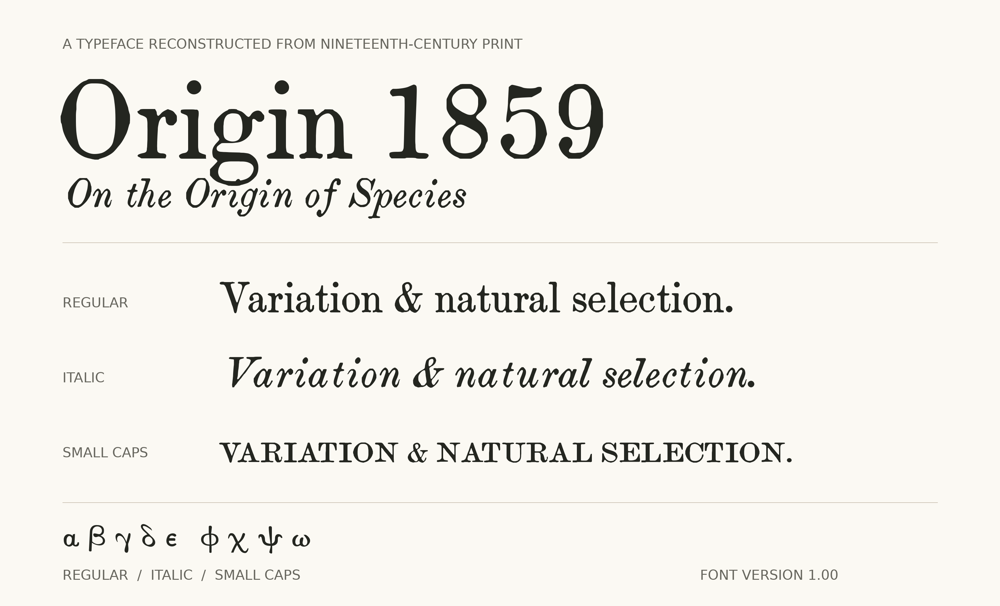
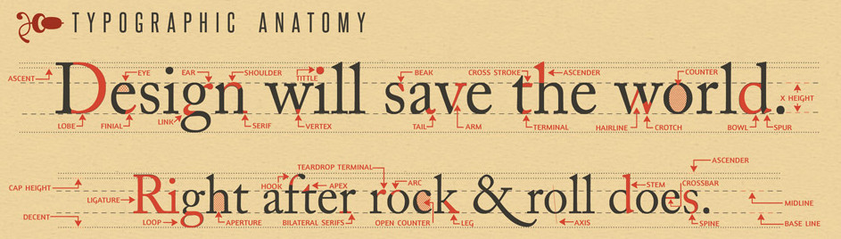

# Origin 1859 Book & Font

This project is an attempt to create an appealing, vintage-style digital font
for scientific writing and science hobby projects. Charles Darwin’s *On the
Origin of Species*—one of the most recognizable scientific books of the
nineteenth century—provides a natural source material for this project.

It is also an experiment in the capabilities of modern large language models:
I am using **ChatGPT 6** to streamline the process of reconstructing historical
letterforms and reproducing the book’s typography and layout.

The project currently includes a [digital font family](/fonts/) based on the **first
edition of Darwin’s *On the Origin of Species* (1859)** and a [**compact PDF
reconstruction of the book typeset with these fonts**](/book/). The book is available
as an editable Word document, two PDF exports, and a reflowable EPUB.

Font design and reconstruction: **Michael Koksharov**, using [multiple cycles
of **ChatGPT 6 Work**](https://chatgpt.com/share/6afdda47-7e64-83ea-bc02-dcb7b0086fcf). Charles Darwin is the author of the original book.

## Download

| Material | File |
| --- | --- |
| Book — PDF, LibreOffice export | [PDF](book/Darwin-Origin-1859-Text.pdf), 3.8 Mb |
| Book — PDF, Microsoft Office export | [Office PDF](book/Darwin-Origin-1859-Text-MSOffice.pdf), 2.8 Mb |
| Book — reflowable EPUB | [EPUB](book/Darwin-Origin-1859-Text.epub), 1.5 Mb |
| Editable book | [Word DOCX](book/Darwin-Origin-1859-Text.docx), 2 Mb |
| Regular font, 1.00 | [Origin1859-Regular.ttf](fonts/ttf/Origin1859-Regular.ttf) |
| Italic font, 1.00 | [Origin1859-Italic.ttf](fonts/ttf/Origin1859-Italic.ttf) |
| Small caps font, 1.00 | [Origin1859-SmallCaps.ttf](fonts/ttf/Origin1859-SmallCaps.ttf) |

Both PDF exports have **544 pages**, including the preliminary matter, folded
diagram and its reverse, main text, index, and publisher’s catalogue.
The DOCX embeds the same three fonts provided here. Install the TTF files
for editing, and use a PDF for a fixed reading layout. The EPUB embeds the same
fonts, reflows to fit the reading device, and provides chapter and original-page
navigation.

The Microsoft Office PDF was saved from the DOCX in Microsoft Word for
Microsoft 365 and is approximately **2.90 MB**, compared with **3.94 MB** for
the LibreOffice PDF. Both display the fractions correctly. The LibreOffice PDF
also includes searchable text values for the fraction artwork; copying and
searching those fractions can differ in the Office export.

## About the reconstruction

Letterforms were recovered from scans, compared across repeated impressions,
and refined as vector outlines. Spacing and kerning were adjusted for readable
text while retaining the character of the source printing. The Greek letterforms
were reconstructed from the type used in Raphael Kühner’s Greek grammar
(1859), then adapted to match the Origin fonts. The Greek letterforms were added to cover routine scientific use; the "mu/micro sign" was designed to be slightly different from the mu letter (μ).

The book combines scan-derived text with comparison against the first-edition
transcription and images. Its layout preserves printed page boundaries,
justification, running heads, italics, small caps, superscripts, rules, index
columns, and catalogue structure. Missing leaves were reconstructed from
another first-edition source. The folded diagram remains an image.

This is a historical reconstruction, not an exact recovery of the original
metal type or a fully proofread critical edition. Fine details and occasional
transcription or layout errors may remain.

## Documentation

- [Overall generation process](docs/GENERATION.md)
- [Book contents and editing notes](book/README.md)
- [Font installation, coverage, and design notes](fonts/README.md)
- [Sources and acknowledgements](docs/SOURCES.md)
- [Rights and included licenses](LICENSE.md)

[SHA256SUMS](SHA256SUMS) records the checksums of the repository’s files.
