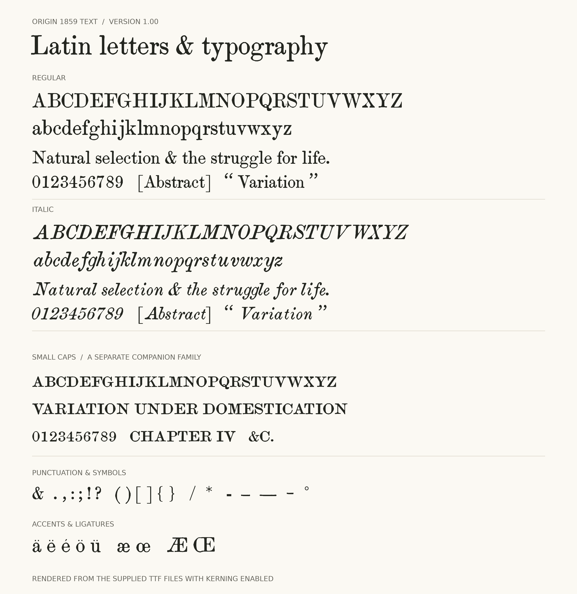
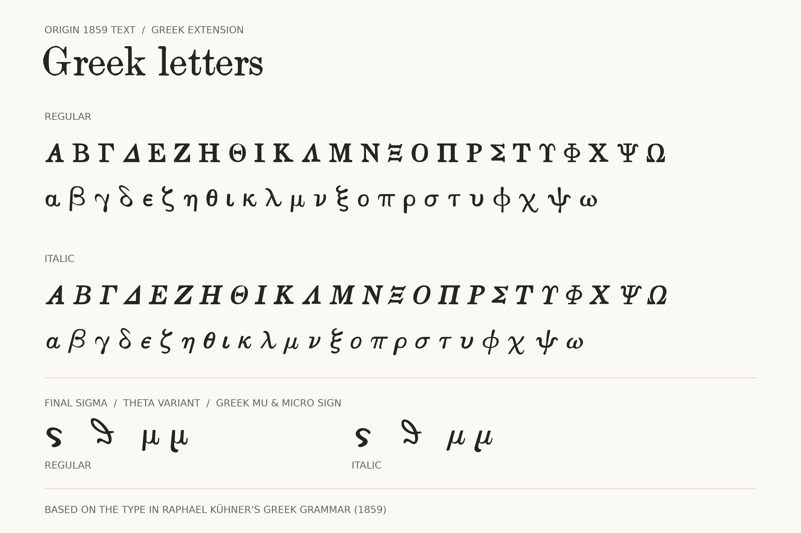
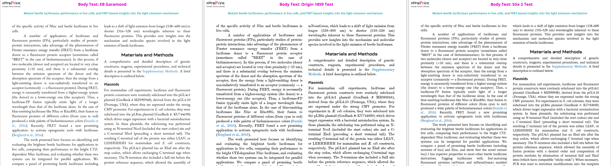
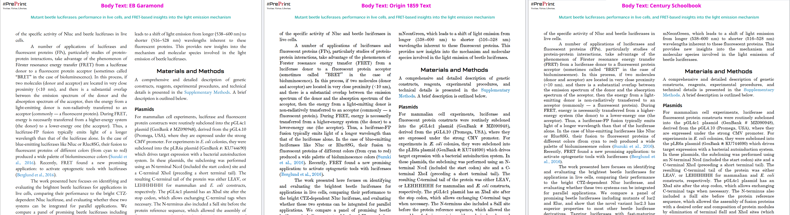
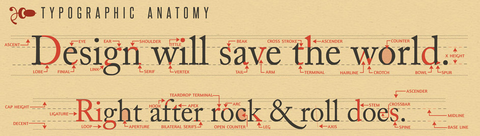

# Origin 1859 Text fonts

Designed by **Michael Koksharov using multiple cycles of ChatGPT 6 Work**.
All three supplied TrueType fonts identify themselves as **Version 1.00**.
They contain vector outlines and permit unrestricted document embedding.

| File | Family to select | Style | Unicode mappings |
| --- | --- | --- | --- |
| [Origin1859-Regular.ttf](ttf/Origin1859-Regular.ttf) | Origin 1859 Text | Regular | 190 |
| [Origin1859-Italic.ttf](ttf/Origin1859-Italic.ttf) | Origin 1859 Text | Italic | 190 |
| [Origin1859-SmallCaps.ttf](ttf/Origin1859-SmallCaps.ttf) | Origin 1859 Text Small Caps | Regular | 139 |

## Specimens

These specimens are rendered directly from the supplied version 1.00 TTF files
with kerning enabled. Click an image to inspect it at full resolution.

## Design

The Latin letterforms reproduce the general appearance of the text type in
the 1859 *Origin*, using repeated printed impressions as references. They are
scan-based reconstructions, with local contour cleanup and deliberate Bézier
redrawing. The original foundry and exact historical typeface identification
have not been established.

The Regular and Italic include basic Greek capitals and lowercase letters,
final sigma, a theta variant, and a distinct micro sign. Greek forms were
reconstructed from Kühner’s 1859 grammar and adapted to the Origin faces.
The slanted Greek follows the source printing; upright Greek includes
geometric adaptations. The micro sign has an adapted left descender distinct
from Greek mu, informed by [GFS Artemisia](https://www.greekfontsociety-gfs.gr/typefaces/20th_21st_century) typeface as a visual reference. No Artemisia
outline data were imported.

The Small Caps is a separate companion family. Its letters are approximately
lowercase height; both uppercase and lowercase input map to small-cap forms.
It is not a Greek small-caps family. Italic numerals and some added accented
letters and symbols are adapted constructions rather than independent traces
of every historical character.

## Installation and use

1. Install all three TTF files using the operating system’s font installer.
2. Restart Word or other applications that were open during installation.
3. Select **Origin 1859 Text** for regular text and its linked Italic style
   for italic passages. Select **Origin 1859 Text Small Caps** separately.
4. Enable kerning in applications that make it optional. Word’s advanced Font
   settings can enable it at the sizes used in the document.

There is no supplied bold face. A program may synthesize bold if requested.
Coverage is intentionally limited: these fonts are not complete Latin,
polytonic Greek, or mathematical families. Applications may substitute another
font for absent characters.

See [character-coverage.tsv](character-coverage.tsv) for exact mappings and
[metadata.json](metadata.json) for the embedded names and technical fields.
Some scan irregularity remains; the fonts do not claim to recover the original
metal punches exactly.

## Comparison of fonts in a scientific manuscript

Below the "Origin 1859 Text" font is compared with "[EB Garamond](https://fonts.google.com/specimen/EB+Garamond)" and "[Stix 2](https://www.stixfonts.org/)" fonts in a page of a [scientific paper manuscript](https://doi.org/10.17605/OSF.IO/EZU6F):
 (The first two fonts are set to 11 pt size while the third is 10 pt size to have approximately the same actual letter sizes.)

As a comparison, "[Century SchoolBook](https://learn.microsoft.com/en-us/typography/font-list/century-schoolbook)" is used in another side-by-side presentation, as a font from the same stylistic type ([Scotch Roman font genre](https://en.wikipedia.org/wiki/Century_type_family)) visually relatively close to the "Origin 1859":

## License

The existing font metadata permits free use, modification, and redistribution,
including commercial use, and links to **CC0 1.0**. 
 See the [license scope](../LICENSE.md) and [CC0 text](../licenses/CC0-1.0.txt).

